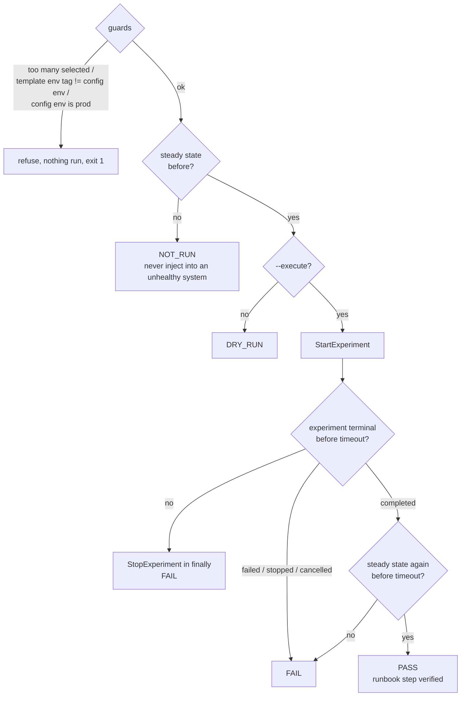

# Chaos runner for AWS FIS with recovery checks

A Python script that runs AWS Fault Injection Service (FIS) experiments one
at a time and checks that the system recovers on its own within a time
limit, as the matching runbook step says it should. Experiments are
declared in YAML. It is a **dry run** unless you pass `--execute`.

> **Status:** AWS FIS only. **Azure Chaos Studio is not implemented.**
> 27 pytest tests drive the runner with a fake FIS client, an injected
> clock and sleep, and a fake steady-state check that goes down and comes
> back on the shared clock. They cover the guards, dry run, recovery in
> time, no recovery, stuck experiments, API errors and a failed stop.
> Nothing has started a real FIS experiment. The default HTTP check and the
> boto3 wiring are not exercised by tests.

## Problem

> Develop a chaos engineering script (using AWS FIS / Azure Chaos Studio
> APIs or custom) that injects common failures and verifies recovery
> runbooks.

## Experiments file

The FIS experiment templates (what to break, stop conditions, IAM role)
are created separately in FIS. This file says how to judge each one:

```yaml
environment: staging
experiments:
  - name: stop-one-api-task
    template_id: EXT1a2b3c4d5e6f7a
    steady_state:
      url: https://api.staging.example.com/healthz
      expect_status: 200
    recovery_timeout_seconds: 300
    runbook_step: "RB-12 step 1: ECS replaces the stopped task; no action needed"
```

## Flow per experiment



- The **recovery timeout** runs from the start call: the experiment must
  finish **and** the steady-state check must pass again within it.
- **Time to recover** is from the start call to the first passing
  steady-state check.
- **Always stopped:** if anything goes wrong after the experiment starts
  (timeout, API error, crash in the watch loop), a `finally` block calls
  `StopExperiment`.
- **If the stop itself fails**, that experiment is marked `STOP_FAILED` and
  nothing further is started in the run (a fault may still be live). The
  report is still written, with a STOP FAILED banner at the top and the
  error in that experiment's log, and results of experiments that ran
  earlier are kept. The script prints the experiment ID with the instruction
  to stop it in the FIS console (or `aws fis stop-experiment --id <id>`) and
  exits with code **3**.

## Safety

- **Dry run by default.** Without `--execute`, nothing is injected; guards
  and the steady-state check still run.
- **Environment guard:** the config may not name `prod` or `production`,
  and every FIS template must carry an `environment` tag equal to the
  config's environment. A mismatch refuses the whole run before anything
  starts.
- **Cap:** `--max-experiments` (default 1). Selecting more than the cap is
  refused, not trimmed. Use `--only <name>` to pick experiments.
- Each start sends a fresh `clientToken`, so an SDK retry of the same call
  can't start a second copy of the experiment.
- FIS stop conditions (CloudWatch alarms on the template) remain the first
  line of defence; this script adds a second one.

## Usage

```bash
python -m pip install -r requirements-dev.txt
python -m ruff check .
python -m ruff format --check .
python -m pytest -q

# Dry run (default)
python -m chaos --config experiments.yaml --only stop-one-api-task

# Inject for real (staging only, one experiment)
python -m chaos --config experiments.yaml --only stop-one-api-task --execute
```

| Exit code | Meaning |
|---|---|
| 0 | every selected experiment passed, or the dry run passed |
| 1 | any FAIL or NOT_RUN, a refused guard, or a bad config |
| 3 | an experiment could not be stopped and may still be running: stop it in the FIS console now (takes priority over 1) |

The report (`chaos-report.md`) lists each experiment's result, time to
recover, whether its runbook step was verified, and a timestamped log.

## Limits

- AWS FIS only; Azure Chaos Studio is not implemented.
- The steady-state check is one HTTPS status code. Real checks would look
  at error rates or latency from metrics.
- Experiments run one after another, never in parallel.
- "Runbook verified" means the system recovered without help in time. Runbook
  steps that need a human are not exercised.
- If stopping an experiment fails, the script can only tell you; it does not
  retry the stop or remove the fault itself.

## Security notes

- The script needs `fis:GetExperimentTemplate`, `fis:StartExperiment`,
  `fis:GetExperiment`, `fis:StopExperiment` and `fis:TagResource`. Scope
  `StartExperiment` to templates tagged with the right environment.
- What an experiment may break is governed by the FIS template's own IAM
  role, not by this script.
- No credentials in code; boto3 uses the standard credential chain.

## Idempotency

Running the script again starts new experiments; chaos runs are not
idempotent by nature. The dry run is read-only and repeatable.
